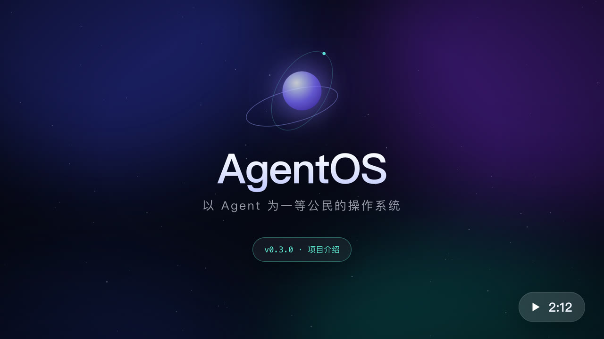
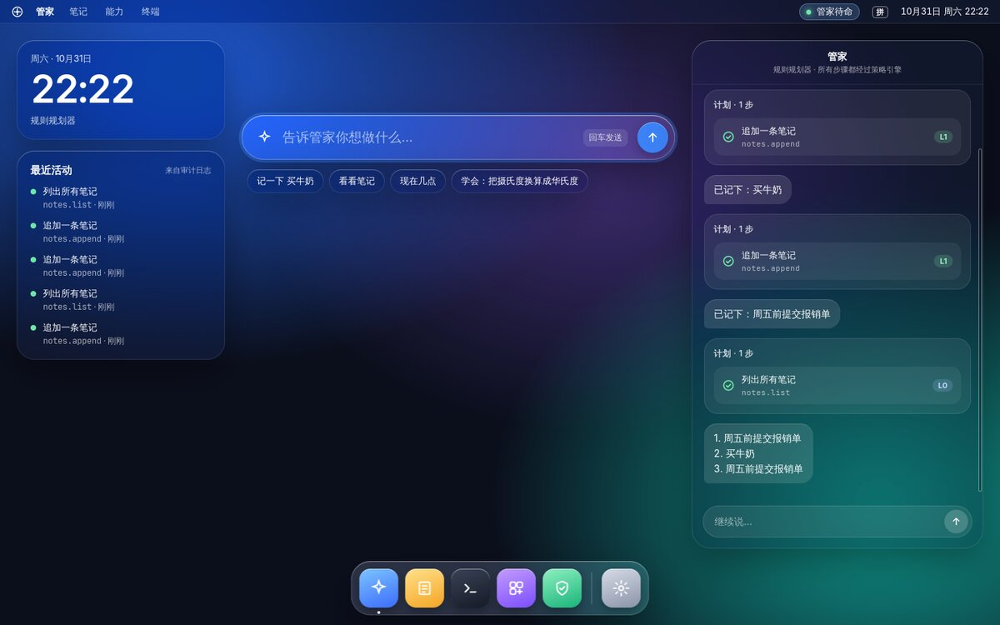
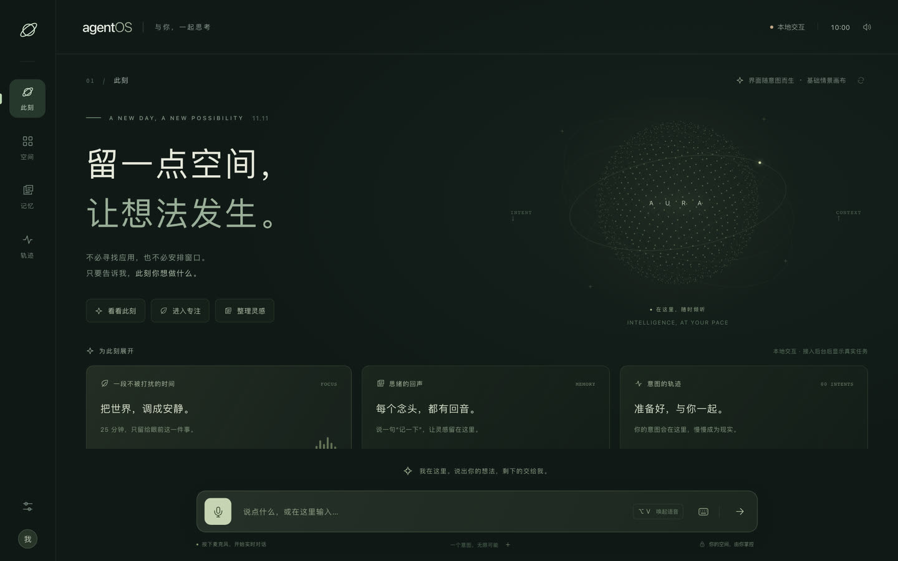

# AgentOS

一个以 Agent 为一等公民的操作系统，目标是让人和 AI 更顺畅地协作：Agent 通过各种输入设备接收人的意图，通过输出设备与人沟通并展示自己的工作。

[](docs/media/agentos-intro.mp4)

<sub>▶ 点击封面播放 [介绍视频](docs/media/agentos-intro.mp4)（2 分 12 秒，1080p，带字幕）：架构、原生桌面、安全模型、v0.3 的持久任务服务与 Web Shell、安装方法。</sub>

AgentOS 构建在 Linux 内核之上，在用户态自建完整的 Agent OS 层：意图总线、Agent 运行时、统一的感知/表达设备抽象，以及基于能力令牌和风险分级的权限模型。

## 项目状态

截至 2026-11-12：

- **版本**：`main` 分支是 v0.3.0 加上[更新日志](CHANGELOG.md)里“未发布”的改动。v0.3.0 没有打 tag、没有发布镜像；最新发布版是 **v0.2.2**（2026-11-02），[Releases](https://github.com/Integ/agentos/releases) 里的镜像是这一版。
- **一个任务内核**：任务内核是 `agentos-taskd`：持久任务、多轮规划、子 Agent、黑板、MCP、插件、智能家居、PIN 和哈希链审计都在这一个服务里，终端、Web Shell 和原生桌面都通过同一个协议连接它。镜像目前仍默认启动旧的 `agentosd`，因为按住说话的本机语音还没有迁过来；见[架构](docs/architecture.md#尚未合并的部分)。给写代码的 Agent 的说明在 [AGENTS.md](AGENTS.md)。

两个守护进程现在共用规划器、审计日志和各项能力的代码，区别只剩下面这些：

| | `agentos-taskd`（任务内核） | `agentosd`（过渡期保留） |
| --- | --- | --- |
| 定位 | 新功能加在这里 | 待删除，不再加新功能 |
| 界面 | `agentos` 命令与终端工作台、Web Shell、原生桌面（`agentos-shell --taskd`） | 原生桌面（默认方式）、控制台 |
| 只有它有 | 协议 v1、分页历史、变更通知、只读能力的直接查询 | 按住说话的本机语音、崩溃后在桌面上的提示 |
| 重启后 | 未完成的任务标为“已中断”，不自动重做 | 从检查点接着做 |
| L3 操作 | 设置 PIN 后等待批准，批准必须带 PIN；没有设置 PIN 时拒绝 | 你确认后执行；设置 PIN 后还要输入 PIN |
| 语音 | Web Shell 的 WebRTC 实时对话，音频发给模型服务 | 按住说话 + 朗读，云端或本机后端 |
| 怎么得到 | 从源码运行，镜像里还没有 | 发布镜像默认启动，可在线更新 |
| 状态目录 | `~/.local/state/agentos` | `~/.local/share/agentos` |

两个状态目录之间没有数据迁移。

- **CI 覆盖**：Ubuntu 上的格式、Clippy、全部测试和在线更新模拟测试；macOS 和 Rust 1.88 上任务内核一侧的测试；Web Shell 的前端测试；cargo-deny。
- **还没有验证**：
  - 任务服务一侧（合并时列出）：`agentos-shell --taskd` 的窗口界面没有实际打开看过；真实的模型接口、MCP server 和 Home Assistant 没有在任务服务上跑过；合并后没有跑镜像构建和 QEMU 冒烟测试。
  - 真机（v0.2.0 发布时列出，之后没有更新过）：Caps Lock 按键说话和指示灯、真实麦克风和扬声器；真实的 Home Assistant 和 MCP 服务器；从一个发布版本在线升级到下一个发布版本。v0.2.2 的修复来自 Intel N100 小主机和笔记本上的真机测试。

已知缺口：

- 合并还差最后一步：把本机语音和崩溃提示迁到任务服务，把镜像切到 `agentos-taskd` + `agentos-shell --taskd`，迁移数据，然后删除 `agentosd`。见[架构](docs/architecture.md#尚未合并的部分)。
- v0.3.0 还没有发版，`agentos-taskd`、`agentos-web-shell` 和 `agentos` 命令没有进镜像和更新包。
- 任务串行执行（单 worker）；除插件在 bubblewrap 沙箱里以外，能力与服务同进程运行，没有进程隔离。见[架构](docs/architecture.md#其他边界)。
- 没有本机唤醒词，没有定时任务（见 [docs/agents.md](docs/agents.md#尚未实现)）。
- Web Shell 是浏览器里的本地界面，不是桌面合成器；实时语音会把音频发给模型服务，不是全本地语音。
- 仓库里还没有 LICENSE 文件，使用和分发条款尚未声明。

## 现在能做什么

- **管家 Agent + 子 Agent**：用自然语言下达意图，管家拆解任务、派给子 Agent；任务即进程，每一步写检查点，守护进程重启后接着做；子 Agent 通过共享黑板协作，可选模型裁判在有影响的步骤前复核。见 [docs/agents.md](docs/agents.md)。
- **云端大模型规划**：Claude（默认 `claude-opus-5-5`）或任意 OpenAI 兼容接口（OpenAI、DeepSeek、通义千问、Ollama 等）；也有离线规则规划器。限流和 5xx 自动重试。
- **玻璃风格桌面**：WebKit 写的 `agentos-shell`，带玻璃风格终端和确认弹窗。见 [docs/shell.md](docs/shell.md)。
- **图形设置助理**：首次进入桌面时出现 Liquid Glass 风格的设置助理，一页一件事：Wi‑Fi、模型接口（带 DeepSeek/通义千问/Ollama 预设）、语音、Home Assistant（可当场测试连接）、PIN、安装到硬盘。系统菜单「网络和 AI 设置…」可随时重新打开。见 [docs/shell.md](docs/shell.md#设置助理)。
- **语音输入与朗读**：按住麦克风按钮或 **Caps Lock** 说话，松开发送，Caps Lock 指示灯就是录音灯；回复可以读出来。只在按住时录音，没有唤醒词。见 [docs/voice.md](docs/voice.md)。
- **智能家居**：接入 Home Assistant，开灯、调空调是 L1，场景脚本是 L2，开锁、撤防、开车库门是 L3。见 [docs/smart-home.md](docs/smart-home.md)。
- **MCP 工具**：`mcp.json` 里配置的 MCP server，工具自动成为管家的能力。见 [docs/mcp.md](docs/mcp.md)。
- **自我进化**：让 AgentOS 给自己写新能力，以沙箱插件形式安装，可回滚。见 [docs/self-evolution.md](docs/self-evolution.md)。
- **安全模型**：能力令牌 + 风险分级确认（L0–L3）；污点追踪（网络插件、MCP 输出会让后续有影响的操作都要确认）；L3 操作可要求 PIN；审计日志带 SHA-256 哈希链，可校验；插件有 bubblewrap 沙箱和资源上限（内存 1 GiB、CPU 10 秒等）。
- **持久任务与多个界面（v0.3）**：`agentos-taskd` 把任务放在后台服务里，命令行、终端工作台、浏览器和原生桌面通过同一个 Unix socket 协议连接；关掉界面任务照常进行，历史可分页，变更实时通知，批准绑定到具体任务的具体步骤。见 [docs/persistent-workspace.md](docs/persistent-workspace.md)。
- **情景式 Web Shell（v0.3）**：语音优先的浏览器界面，模型根据真实任务和笔记组织画面（只能选组件、顺序和宽度）；WebRTC 实时语音可连续对话、开口打断，但语音不能代替批准。见 [docs/ambient-shell.md](docs/ambient-shell.md)。
- **稳健性与运维**：守护进程崩溃时写入 journal 和 `crash.txt`、退避重启，并在桌面「最近活动」里提示；journal 跨重启保留；`sudo agentos-update` 在线更新，先自检再替换，可回滚。

更多文档：

- 设计草案：[AgentOS 架构设计草案](https://claude.ai/artifact/RzRDjHkBbJVbnyFDRSZ4BN)
- 架构：[docs/architecture.md](docs/architecture.md)，[Unix socket 协议 v1](docs/protocol-v1.md)
- 任务服务、命令行与工作台：[docs/persistent-workspace.md](docs/persistent-workspace.md)
- 历史设计：[docs/v0.3-design.md](docs/v0.3-design.md)、[docs/v0.2-design.md](docs/v0.2-design.md)
- 安装：[docs/install.md](docs/install.md)，在线更新：[docs/update.md](docs/update.md)

## 安装到 PC

到 [Releases](https://github.com/Integ/agentos/releases) 下载镜像（目前是 v0.2.2，Debian 13 或 Ubuntu 24.04 两种），写进 U 盘，从 U 盘启动即可使用；设置助理里可以一键装到硬盘。需要 x86-64、UEFI 启动，安全启动可以保持开启。详见 [docs/install.md](docs/install.md)。

- 镜像自带 Intel、NVIDIA、MediaTek 显卡固件、声卡 SOF 固件和 CPU 微码，Intel N100 这类核显小主机可以直接进桌面。
- 内置 fcitx5 拼音输入法；笔记本触摸板默认开启轻触点击。
- 图形桌面起不来时自动退回文本模式（fbterm，中文正常显示），原因记在 `journalctl -t agentos-sway`。

### 升级

已经装好的机器运行 `sudo agentos-update`（或系统菜单「检查更新…」），可 `--rollback`。详见 [docs/update.md](docs/update.md)。

- **从 v0.1.0 升级**：必须重新写入镜像（v0.1.0 的 `sudo` 会要密码，无法运行更新）。
- **从 v0.2.0 升级**：建议重新写入镜像。在线更新只更新 AgentOS 自己的文件，不会安装新的系统软件包，所以 v0.2.2 的显卡固件和输入法候选窗口修复拿不到。不想重装的话，在线更新后再运行（Ubuntu 镜像不需要第一条）：

  ```sh
  sudo apt install firmware-intel-graphics firmware-intel-misc firmware-nvidia-graphics firmware-mediatek firmware-sof-signed intel-microcode amd64-microcode
  sudo apt install fcitx5-frontend-gtk3 fbterm
  ```

## 仓库结构

```
crates/
  core/      词汇表：Intent、Percept、Expression、Capability，Sensor/Output trait
  runtime/   持久任务：状态、步骤、分页、通知、取消与重启中断
  ipc/       本地控制协议 v1：严格校验、有界帧与本机路径约定
  policy/    策略引擎：能力授权 + 风险分级确认 + 污点
  audit/     只追加审计日志：同步落盘、单一写入者、哈希链
  planner/   规划契约、离线规则规划器、Claude 与 OpenAI 兼容规划器
  services/  能力注册表、子 Agent、黑板、裁判、PIN、MCP、插件与自我进化、智能家居
  taskd/     任务内核 agentos-taskd：管家循环、内置能力、控制服务
  cli/       agentos 命令与终端任务工作台
  web-shell/ 浏览器界面 agentos-web-shell：情景布局与连续实时语音
  shell/     原生桌面 agentos-shell：玻璃风格桌面与设置助理
  agentosd/  过渡期保留的旧守护进程（本机语音、现有镜像）
image/       可启动磁盘镜像：构建脚本、系统集成文件（设置助理、会话脚本、agentos-update）、OTA 更新包、QEMU 冒烟测试
docs/        各部分的文档；docs/media/intro-video/ 是介绍视频的源文件
```

## 快速开始

需要 Rust 1.88+。

```sh
cargo run -p agentosd
```

各程序都支持 `--help` 和 `--version`（例如 `cargo run -p agentosd -- --help`），写错的参数会报错退出，而不是被忽略。

然后输入意图，例如：

```
记一下 买牛奶
看看笔记
现在几点
清空笔记      # L3 不可逆操作，会先请求确认
y
```

### 图形界面

```sh
cargo run -p agentosd -- --listen $XDG_RUNTIME_DIR/agentos.sock
cargo run -p agentos-shell -- --windowed   # 需要 libwebkit2gtk-4.1-dev
```



按住界面上的麦克风按钮（或 Caps Lock）可以语音输入，配置方法见 [docs/voice.md](docs/voice.md)。界面说明见 [docs/shell.md](docs/shell.md)。

### 持久任务与情景式 Web Shell

在三个终端中分别启动（同一个状态目录）：

```sh
cargo run -p agentos-taskd -- --planner rule --state-dir /tmp/agentos-workspace
cargo run -p agentos-web-shell -- --state-dir /tmp/agentos-workspace
cargo run -p agentos-cli -- --state-dir /tmp/agentos-workspace workbench
```

打开 Web Shell 输出的完整本机链接。它支持模型根据任务和上下文生成受限布局、连续实时语音及开口打断；API 密钥仅由服务端读取。完整配置见[情景式 Shell](docs/ambient-shell.md)。



任务服务提供全部能力：把 `mcp.json`、`agents/` 放进状态目录，设置 `HASS_URL` / `HASS_TOKEN`，运行 `agentos-taskd --set-pin` 设置 PIN。原生桌面用 `cargo run -p agentos-shell -- --windowed --task-socket /tmp/agentos-workspace/control.sock` 连接同一个服务。它与旧的 `agentosd` 使用不同的状态目录，数据不互相迁移。命令行用法、状态目录和批准规则见 [docs/persistent-workspace.md](docs/persistent-workspace.md)。

### 用 Claude 做规划

设置 `ANTHROPIC_API_KEY` 后，`agentosd` 自动改用 Claude 规划器（默认模型 `claude-opus-5-5`）：每个意图调用一次 Messages API，所有能力作为工具提供，模型返回的工具调用按顺序成为计划步骤，仍然逐步经过策略引擎。

```sh
export ANTHROPIC_API_KEY=...
cargo run -p agentosd                    # 自动使用 Claude
cargo run -p agentosd -- --planner rule  # 强制使用离线规则规划器
```

可选环境变量：`AGENTOS_MODEL`（换模型）、`ANTHROPIC_BASE_URL`（换 API 地址）。

### 用 OpenAI 兼容接口做规划

任何兼容 OpenAI Chat Completions 的服务都可以（OpenAI、DeepSeek、通义千问、Moonshot，或本地的 Ollama、vLLM、LM Studio），需要支持 function calling。

```sh
# 云端服务
export OPENAI_API_KEY=...
export OPENAI_BASE_URL=https://api.deepseek.com/v1   # 不设则为 https://api.openai.com/v1
export OPENAI_MODEL=deepseek-chat
cargo run -p agentosd -- --planner openai

# 本地 Ollama（不需要 key）
OPENAI_BASE_URL=http://localhost:11434/v1 OPENAI_MODEL=qwen3 cargo run -p agentosd
```

规划器选择：`--planner claude|openai|rule`（或环境变量 `AGENTOS_PLANNER`）。不指定时，设置了 `ANTHROPIC_API_KEY` 就用 Claude，否则配置了 OpenAI 兼容接口就用它，都没有则用离线规则规划器。

### 自我进化

配置了大模型（Claude 或 OpenAI 兼容接口）后，可以让 AgentOS 给自己写新能力：

```
学会：把摄氏度换算成华氏度   # 生成插件、沙箱自测，展示代码和权限
y                             # 确认安装（L3）
37 摄氏度是多少华氏度          # 新能力立即可用（需要 LLM 规划器）
看看插件
回滚 unit.c_to_f
```

插件在 bubblewrap 沙箱中运行（`apt install bubblewrap python3`），存放在 `~/.local/share/agentos/evolve`（`--home` 或 `AGENTOS_HOME` 可改）。详见 [docs/self-evolution.md](docs/self-evolution.md)。

数据目录默认是 `~/.local/share/agentos`（`--home` 或 `AGENTOS_HOME` 可改），笔记保存在其中的 `notes.json`，重启后还在。审计日志默认写到数据目录里的 `audit.jsonl`，可用 `--audit <路径>` 或环境变量 `AGENTOS_AUDIT` 指定。每条记录都带上一条的 SHA-256（哈希链），`agentosd --verify-audit` 可以检查中间有没有记录被改过、删过或插入过；想防止整段重写或截掉末尾，可以把它输出的“链头”另外记下来。

### 智能家居

设置 `HASS_URL` 和 `HASS_TOKEN`（Home Assistant 长期访问令牌）后，管家可以查看和控制家里的设备：开灯、调空调、拉窗帘属于 L1，运行脚本和场景属于 L2，开锁、撤防、开车库门属于 L3。详见 [docs/smart-home.md](docs/smart-home.md)。

### MCP 工具

在数据目录放一个 `mcp.json`（格式同 Claude Desktop 的 `mcpServers`），MCP server 的工具就会成为管家的能力。没有特别设置时，每次调用都要确认，结果也当作不可信。详见 [docs/mcp.md](docs/mcp.md)。

### 不可逆操作的 PIN

L3 操作（删除数据、安装插件等）默认只要点“确认执行”。设置 PIN 后，确认框会要求输入 PIN，键盘回复 y 或语音“确认”都不能单独通过：

```bash
agentosd --set-pin      # 输入两次 4–12 位数字
agentosd --clear-pin    # 取消
```

装机镜像的设置助理里也有设置 PIN 这一步。PIN 以加盐迭代哈希存在数据目录的 `pin.json`（0600），连续输错 5 次锁定 5 分钟，每次核对都记入审计日志（不含 PIN 本身）。控制台模式下先输入 `pin 你的PIN` 再回复 y。它能挡住提示注入、旁人和随手乱试，但挡不住已经能以桌面用户身份运行代码的人。

## 开发

```sh
cargo fmt --all
cargo clippy --all-targets -- -D warnings
cargo test --all
cargo deny check     # 依赖漏洞（RustSec）、许可证、来源；cargo install --locked cargo-deny
node --test crates/web-shell/assets/*.test.mjs   # Web Shell 前端测试，不需要模型密钥
```

`cargo test --all` 里的插件沙箱测试需要 Linux 和 bubblewrap，原生桌面需要 WebKitGTK。在 macOS 上可以只跑 CI 在 macOS 上跑的这一组：

```sh
cargo test -p agentos-taskd -p agentos-web-shell -p agentos-cli -p agentos-ipc -p agentos-runtime -p agentos-audit -p agentos-planner -p agentos-core -p agentos-policy
```

CI 每次提交都会跑上面全部检查，其中这一组在 macOS 和 Rust 1.88 上各跑一遍。`cargo deny check` 另外每周一再跑一次（配置见 [deny.toml](deny.toml)），新披露的依赖漏洞会让 CI 变红。

### 介绍视频

[docs/media/agentos-intro.mp4](docs/media/agentos-intro.mp4) 由 [docs/media/intro-video/](docs/media/intro-video/) 里的源文件生成：`narration.json` 是旁白，`video.html` 是画面，界面镜头是两套真实界面的截图。配音用微软 Edge 的神经网络语音（[edge-tts](https://github.com/rany2/edge-tts)，需要联网，旁白文字会发给微软的语音服务）。功能有变化时改旁白和画面，然后重新生成（需要 Node 22+、Python 3、ffmpeg 和一个 Playwright 的 headless Chromium）：

```sh
cd docs/media/intro-video
npm install
python3 -m venv .venv && .venv/bin/pip install edge-tts
node capture.mjs            # 截取原生桌面（演示模式）和 Web Shell（离线模式）
.venv/bin/python tts.py     # 合成配音，生成时间轴和字幕
node render.mjs             # 逐帧渲染并合成 mp4 和封面
```

中间产物在 `out/intro-video/`（不进仓库）。
