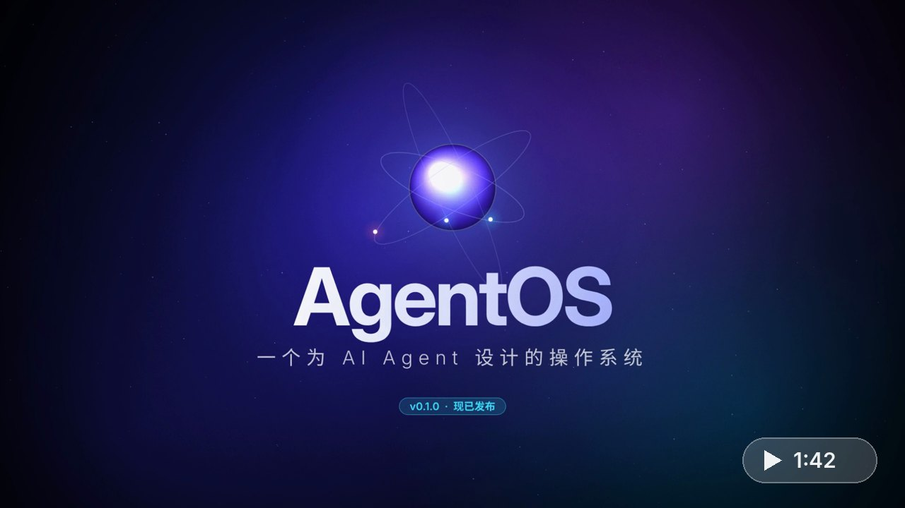

# AgentOS

一个以 Agent 为一等公民的操作系统，目标是让人和 AI 更顺畅地协作：Agent 通过各种输入设备接收人的意图，通过输出设备与人沟通并展示自己的工作。

[](docs/media/agentos-intro.mp4)

<sub>▶ 点击封面播放 [介绍视频](docs/media/agentos-intro.mp4)（1 分 42 秒，720p）：功能一览与安装方法。</sub>

AgentOS 构建在 Linux 内核之上，在用户态自建完整的 Agent OS 层：意图总线、Agent 运行时、统一的感知/表达设备抽象，以及基于能力令牌和风险分级的权限模型。

- 设计草案：[AgentOS 架构设计草案](https://claude.ai/artifact/RzRDjHkBbJVbnyFDRSZ4BN)
- 架构概要与 P0 进度：[docs/architecture.md](docs/architecture.md)
- 管家调度子 Agent：[docs/agents.md](docs/agents.md)
- 自我进化：[docs/self-evolution.md](docs/self-evolution.md)
- 图形界面：[docs/shell.md](docs/shell.md)
- 语音输入与朗读：[docs/voice.md](docs/voice.md)

## 安装到 PC

下载镜像写进 U 盘，从 U 盘启动即可使用，首次设置里可以一键装到硬盘（UEFI，支持安全启动）。详见 [docs/install.md](docs/install.md)。

升级已经装好的机器：`sudo agentos-update`（从 GitHub Release 下载更新包，先自检再替换，可 `--rollback`）。详见 [docs/update.md](docs/update.md)（v0.1.0 不能原地升级，需要重新写镜像）。各版本变化见 [CHANGELOG.md](CHANGELOG.md)。

## 仓库结构

```
crates/
  core/      核心类型：Intent、Percept、Expression、Capability，Sensor/Output trait
  policy/    策略引擎：能力授权 + 风险分级确认 + 污点追踪
  audit/     只追加审计日志（JSON Lines），可回放
  agentosd/  P0 守护进程：感知中枢 → 管家 Agent → 表达中枢；插件运行时与自我进化（evolve）
  shell/     图形界面 agentos-shell：玻璃风格桌面，通过 Unix socket 连接 agentosd
image/       可启动磁盘镜像：构建脚本、系统集成文件、QEMU 冒烟测试
```

## 快速开始

需要 Rust 1.80+。

```sh
cargo run -p agentosd
```

然后输入意图，例如：

```
记一下 买牛奶
看看笔记
现在几点
清空笔记      # L3 不可逆操作，会先请求确认
y
```

### 图形界面

```sh
cargo run -p agentosd -- --listen $XDG_RUNTIME_DIR/agentos.sock
cargo run -p agentos-shell -- --windowed   # 需要 libwebkit2gtk-4.1-dev
```


详见 [docs/shell.md](docs/shell.md)。

### 用 Claude 做规划

设置 `ANTHROPIC_API_KEY` 后，`agentosd` 自动改用 Claude 规划器（默认模型 `claude-opus-5-5`）：每个意图调用一次 Messages API，所有能力作为工具提供，模型返回的工具调用按顺序成为计划步骤，仍然逐步经过策略引擎。

```sh
export ANTHROPIC_API_KEY=...
cargo run -p agentosd                    # 自动使用 Claude
cargo run -p agentosd -- --planner rule  # 强制使用离线规则规划器
```

可选环境变量：`AGENTOS_MODEL`（换模型）、`ANTHROPIC_BASE_URL`（换 API 地址）。

### 用 OpenAI 兼容接口做规划

任何兼容 OpenAI Chat Completions 的服务都可以（OpenAI、DeepSeek、通义千问、Moonshot，或本地的 Ollama、vLLM、LM Studio），需要支持 function calling。

```sh
# 云端服务
export OPENAI_API_KEY=...
export OPENAI_BASE_URL=https://api.deepseek.com/v1   # 不设则为 https://api.openai.com/v1
export OPENAI_MODEL=deepseek-chat
cargo run -p agentosd -- --planner openai

# 本地 Ollama（不需要 key）
OPENAI_BASE_URL=http://localhost:11434/v1 OPENAI_MODEL=qwen3 cargo run -p agentosd
```

规划器选择：`--planner claude|openai|rule`（或环境变量 `AGENTOS_PLANNER`）。不指定时，设置了 `ANTHROPIC_API_KEY` 就用 Claude，否则配置了 OpenAI 兼容接口就用它，都没有则用离线规则规划器。

### 自我进化

配置了大模型（Claude 或 OpenAI 兼容接口）后，可以让 AgentOS 给自己写新能力：

```
学会：把摄氏度换算成华氏度   # 生成插件、沙箱自测，展示代码和权限
y                             # 确认安装（L3）
37 摄氏度是多少华氏度          # 新能力立即可用（需要 LLM 规划器）
看看插件
回滚 unit.c_to_f
```

插件在 bubblewrap 沙箱中运行（`apt install bubblewrap python3`），存放在 `~/.local/share/agentos/evolve`（`--home` 或 `AGENTOS_HOME` 可改）。详见 [docs/self-evolution.md](docs/self-evolution.md)。

数据目录默认是 `~/.local/share/agentos`（`--home` 或 `AGENTOS_HOME` 可改），笔记保存在其中的 `notes.json`，重启后还在。审计日志默认写到数据目录里的 `audit.jsonl`，可用 `--audit <路径>` 或环境变量 `AGENTOS_AUDIT` 指定。每条记录都带上一条的 SHA-256（哈希链），`agentosd --verify-audit` 可以检查中间有没有记录被改过、删过或插入过；想防止整段重写或截掉末尾，可以把它输出的“链头”另外记下来。

### 智能家居

设置 `HASS_URL` 和 `HASS_TOKEN`（Home Assistant 长期访问令牌）后，管家可以查看和控制家里的设备：开灯、调空调、拉窗帘属于 L1，运行脚本和场景属于 L2，开锁、撤防、开车库门属于 L3。详见 [docs/smart-home.md](docs/smart-home.md)。

### MCP 工具

在数据目录放一个 `mcp.json`（格式同 Claude Desktop 的 `mcpServers`），MCP server 的工具就会成为管家的能力。没有特别设置时，每次调用都要确认，结果也当作不可信。详见 [docs/mcp.md](docs/mcp.md)。

### 不可逆操作的 PIN

L3 操作（删除数据、安装插件等）默认只要点“确认执行”。设置 PIN 后，确认框会要求输入 PIN，键盘回复 y 或语音“确认”都不能单独通过：

```bash
agentosd --set-pin      # 输入两次 4–12 位数字
agentosd --clear-pin    # 取消
```

装机镜像的设置向导里也有设置 PIN 这一步。PIN 以加盐迭代哈希存在数据目录的 `pin.json`（0600），连续输错 5 次锁定 5 分钟，每次核对都记入审计日志（不含 PIN 本身）。控制台模式下先输入 `pin 你的PIN` 再回复 y。它能挡住提示注入、旁人和随手乱试，但挡不住已经能以桌面用户身份运行代码的人。

## 开发

```sh
cargo fmt --all
cargo clippy --all-targets -- -D warnings
cargo test --all
cargo deny check     # 依赖漏洞（RustSec）、许可证、来源；cargo install --locked cargo-deny
```

CI 每次提交和每周一都会跑 `cargo deny check`（配置见 [deny.toml](deny.toml)），新披露的依赖漏洞会让 CI 变红。
