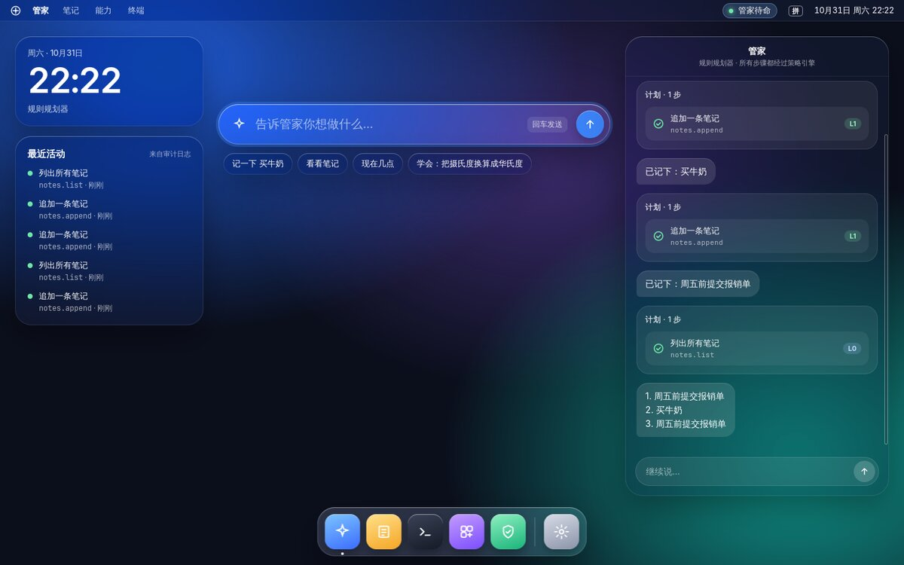
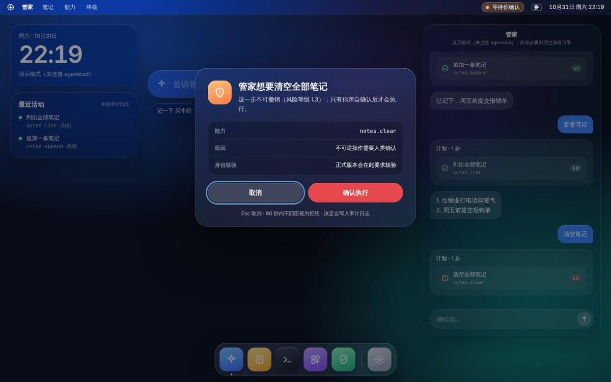
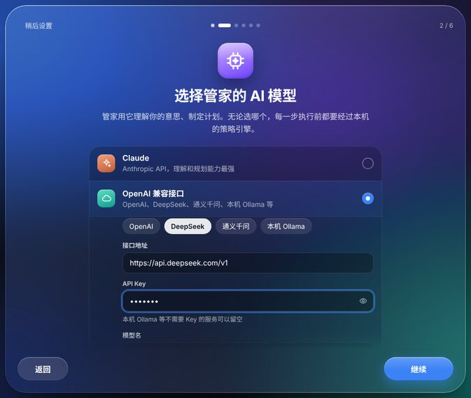

# 图形界面（agentos-shell）

AgentOS 的桌面借鉴了 macOS 的设计语言：半透明玻璃材质、大圆角、菜单栏和 Dock。但整个界面是围绕 Agent 设计的，核心是让人看清管家在做什么、并在关键时刻做决定。设计稿：[AgentOS 桌面设计稿](https://claude.ai/artifact/Rnp5b5VxBdSsKcMSN8DMta)。



| 区域 | 作用 |
| --- | --- |
| 菜单栏 | 左边是系统菜单、“菜单”（Ctrl+K）、笔记、能力、终端；笔记和能力用协议的 `read` 直接显示，不替你提交意图。右边是状态栏：运行中的任务数、待你处理（等你批准或回答）的任务数、任务服务报告的问题数（点开读 `system.status` 看怎么办），没有的不显示，和工作台顶部那一行是同一份数据；再右边的胶囊显示管家状态：待命、思考中、执行到第几步、等待确认、未连接；麦克风打开时亮起橙色标志，朗读时显示“正在播报 · 停止” |
| 唤起管家 | 在任何地方按 Super+空格，顶部弹出输入框，直接对管家说，回车发送。浮在桌面上的终端挡住中间的意图栏时也能用 |
| 菜单 | Super+Alt+空格、Ctrl+K 或菜单栏的“菜单”：列出所有操作（对管家说话、诊断、笔记、能力、任务服务的状态、主题、终端、设置，镜像里还有网络和 AI 设置、更新、安装、重启、关机）。输入就过滤，↑↓ 选择，回车执行；输入的字没有对应的操作时，最后一行是“对管家说”。需要管家去做的项（“诊断一下崩溃”）只把句子填进输入框，由你回车发送 |
| 主题 | 设置里选，或 `agentos theme <名字>`：桌面、从桌面打开的终端、sway 的边框和背景、终端工作台一起换。见下文 |
| 意图栏 | 屏幕中间的主输入框，回车发送；按住麦克风按钮或 Caps Lock 说话（见 [voice.md](voice.md)）；下面是常用意图 |
| 管家面板 | 对话记录。每个计划画成卡片，逐步显示能力名、风险等级（L0–L3）和执行状态 |
| 最近活动 | 来自审计日志的能力调用和确认记录 |
| 提问 | 连接任务服务时，Agent 的提问显示为一条消息，你输入的下一句话就是对它的回答；有提问在等时，输入不会被当成新的意图 |
| 确认弹窗 | 策略引擎要求确认时弹出，列出能力、原因和参数；按钮是“停止任务”（取消整个任务）、“拒绝这一步”（这一步不执行，任务换别的办法继续）和“确认执行”；默认焦点在“拒绝这一步”，Esc 和 60 秒不回应都只拒绝这一步 |
| Dock | 管家、笔记、终端、能力与插件、最近活动、设置（主题、朗读） |



## 结构

```
页面 ui/index.html  ⇄  agentos-shell 里的桥 kernel.rs  ⇄  Unix socket（协议 v1）  ⇄  agentos-taskd
                                                                                    管家 → 策略引擎 → 能力 → 审计
```

- 界面整体画在一个 WebKit 窗口里（`crates/shell/ui/index.html`），所以毛玻璃效果不依赖合成器支持，sway 下也能用。
- 桌面连接任务服务 `agentos-taskd`，通过[协议 v1](protocol-v1.md) 工作：订阅任务变化，读取变化的任务，把它与页面上次看到的样子之间的差别翻译成下面的页面事件；意图是 `submit`，确认是 `approve`（不可逆的步骤带上确认框里输入的 PIN），拒绝是 `cancel`。批准令牌留在桥里，不交给页面。一次运行是一段对话；有问题在等回答时，你说的下一句话就是回答。
- 按住说话：页面的说话键变成 `listen` 请求，任务服务录音和识别；识别出的文字回到这个窗口，先显示出来，再像打字一样提交（标明是说出来的，`auto` 模式下回复会被读出来）。“最近活动”来自任务服务的审计日志（协议的 `activity`）。
- shell 本身没有任何权限。所有操作都经过任务服务的策略引擎并写入审计日志。界面能让 shell 做的本地动作只有系统菜单里固定的几项、切换主题，以及设置助理的几个操作（见下文）。
- 页面只能直接读三个只读能力：`notes.list`、`evolve.list`、`system.status`（协议的 `read`；任务服务本来也只提供只读、输出可信的能力）。菜单栏的状态栏用的是终端工作台同一个查询（`agentos_cli::workbench::waiting_on_user`），在任务换状态时刷新。
- 快捷键通过 `$XDG_RUNTIME_DIR/agentos-shell.sock`（0600）找到正在运行的桌面：`agentos-shell --summon` 和 `--menu` 各发一个词，`agentos theme` 发 `theme`。信号不带任何数据，所以不能替你说话或批准什么，只改变屏幕上显示的东西。
- socket 由任务服务创建，权限是 0600，只有当前用户能连接。

## 运行

依赖（Debian 13 / Ubuntu 24.04）：

```sh
sudo apt install libwebkit2gtk-4.1-dev libgtk-3-dev   # 编译
sudo apt install libwebkit2gtk-4.1-0 fonts-noto-cjk fonts-inter   # 运行
```

```sh
# 终端 1：任务服务（临时状态目录）
cargo run -p agentos-taskd -- --state-dir /tmp/agentos-dev

# 终端 2：图形界面（--windowed 以普通窗口运行，方便开发）
cargo run -p agentos-shell -- --windowed --task-socket /tmp/agentos-dev/control.sock
```

`agentos-shell` 默认连接默认状态目录（`~/.local/state/agentos`）里的 `control.sock`，可用 `--task-socket` 或 `AGENTOS_TASK_SOCKET` 改。任务服务没启动或重启时，shell 每秒重连一次，菜单栏显示“未连接”。旧的 `--taskd` 参数仍然接受，什么也不改变；`--socket`（旧的 agentosd）已经没有了。

在浏览器里直接打开 `crates/shell/ui/index.html` 会进入演示模式：不需要任务服务，内置一个很小的模拟管家，方便调整界面。

### 在 sway 里作为桌面

shell 是唯一的平铺窗口，铺满屏幕；终端等其他程序浮在它上面：

```
default_border none
for_window [app_id="agentos-shell"] border none
for_window [app_id="foot"] floating enable, resize set 960 600, move position center
exec agentos-shell
```

任务服务要先在运行（镜像里由 `agentos-session` 以用户单元启动）。终端程序可用 `AGENTOS_TERMINAL` 指定（默认 `foot`）；是 foot 时用主题的配色打开（`-o colors.…`），别的终端保留它自己的配色。

快捷键和主题：

```
include ~/.config/agentos/sway-theme.conf
bindsym Mod4+space [title="^AgentOS$"] focus; exec agentos-shell --summon
bindsym Mod4+Mod1+space [title="^AgentOS$"] focus; exec agentos-shell --menu
bindsym Mod4+Return exec agentos-shell --terminal
```

`--summon`、`--menu`、`--terminal` 不开窗口：前两个告诉正在运行的桌面，桌面没在运行时退出码为 1；`--terminal` 用主题的配色打开一个终端。

### 主题

`agentos theme` 列出主题，`agentos theme 森林`（或 `forest`）切换；桌面设置和菜单里也能切换。选择存在 `~/.config/agentos/theme`，同时生成 sway 的 `~/.config/agentos/sway-theme.conf`。切换时正在运行的桌面和 sway 马上换好（sway 通过 `swaymsg`），之后打开的终端用新配色，已经开着的终端窗口不变。主题有 夜空（默认）、森林、暮色、炭火、石墨，都是深色；色板只有一份，在 `crates/cli/src/theme.rs`，桌面、终端、sway 和工作台都从这里取，不会各自走样。文件缺失或写了不认识的名字时用默认主题，不会因此启动失败。

安装镜像里已经这样配置好了：`agentos-session` 在登录时启动任务服务，`agentos-desktop` 运行 `agentos-shell`；左上角系统菜单通过 `agentos-system` 执行固定的几项操作（终端、设置、检查更新、安装、重启、关机），shell 拒绝其他任何名字。shell 连上任务服务后会写 `$XDG_RUNTIME_DIR/agentos-shell.ready`，开机自检和 QEMU 冒烟测试用它确认桌面已就绪。

## 页面消息

页面和 shell 之间每条消息是一个 JSON 对象。

页面 → shell：

| 消息 | 含义 |
| --- | --- |
| `{"type":"intent","text":"记一下 买牛奶"}` | 新意图；有问题在等回答时是那个回答 |
| `{"type":"confirm","answer":"approve","task":3}` | 回答待确认的步骤：`answer` 是 `approve`（批准）、`reject`（只拒绝这一步）或 `cancel`（取消整个任务）；`confirm` 事件带 `pin_required` 时加上 `"pin":"1234"`（PIN 由任务服务核对，不会写进任务或审计日志） |
| `{"type":"listen","action":"start"}` | 按下说话键；`stop` 松开并识别，`cancel` 丢弃这次录音 |
| `{"type":"speech","mode":"auto"}` | 朗读模式：`auto` `always` `off` |
| `{"type":"speech","action":"stop"}` | 停止朗读 |
| `{"type":"read","capability":"notes.list"}` | 直接读一个只读能力，只认 `notes.list`、`evolve.list`、`system.status` |
| `{"type":"theme","id":"forest"}` | 换主题：保存给所有界面，并应用到 sway |

shell → 页面：

| 消息 | 含义 |
| --- | --- |
| `hello` | 连接后第一条：规划器名称、版本、语音配置（`voice`：是否可用、识别/合成后端、音频发往哪里、朗读模式） |
| `activity` | 审计日志里最近 20 条能力调用、确认、麦克风使用和崩溃 |
| `plan` | 计划：每一步的能力名、描述、风险等级 |
| `step` | 某一步的状态：`running` `done` `failed` `confirm` `cancelled` |
| `confirm` | 需要人确认：能力、描述、风险、原因、参数、是否需要身份核验 |
| `expression` | 管家说的话（`report` `error` 等） |
| `pin` | 随批准发来的 PIN 不对或已锁定（`message` 说明原因），这一步仍在等待确认 |
| `done` | 这个意图处理完了。`state` 说明结局：`done`（做了或回答了）、`unhandled`（没有办法处理，什么也没执行）、`failed`、`cancelled` |
| `voice` | 麦克风状态 `mic`（`idle` `listening` `transcribing`）、是否在朗读 `speaking`、朗读模式 `speak` |
| `voice_level` | 录音音量（0–1），约每 100 毫秒一次 |
| `transcript` | 这个窗口的录音识别出的文字，随后由 shell 提交 |
| `voice_notice` | 语音相关的提示或错误（没配置、没声音、识别失败等） |
| `theme` | 当前主题的颜色（`base` `glow` `accent` `soft`）和全部主题，给设置里的选择器；保存失败时带 `error` |
| `status` | 状态栏：`running`、`waiting`（等你批准或回答）、`problems`（任务服务报告的警告和错误数）、`planner` |
| `read` | 直接读取的结果：`capability`、`ok`、`text` |
| `summon`、`menu` | 快捷键要求弹出“对管家说”的输入框或菜单 |

## 设置助理



第一次进入桌面（还没有 `/etc/agentos/setup-done`）时，shell 会盖上一层全屏的设置助理；以后从左上角系统菜单的「网络和 AI 设置…」再打开。一页只问一件事：网络（列出附近的 Wi‑Fi，点一下输入密码加入）→ AI 模型（Claude / OpenAI 兼容接口，带 DeepSeek、通义千问、Ollama 预设 / 离线规则）→ 语音 → Home Assistant（可当场测试连接）→ PIN → 是否安装到硬盘 → 总结。输入有问题时直接在对应的输入框下面提示；已经保存过的 API Key 和令牌不会显示，留空就保持不变。前面几步都不会写任何东西，最后一步才一次性保存，然后重启任务服务让它读到新设置。

在浏览器里打开 `crates/shell/ui/index.html#setup`（或 `#setup-again`，模拟已经设置过）可以在演示模式下走一遍。

后端是 `agentos-setup` 的几个选项，shell 通过 `sudo -n` 运行（镜像里桌面用户免密 sudo），答案以 `KEY=VALUE` 行写到 stdin。界面发来的内容先在 `crates/shell/src/setup.rs` 里检查：只接受已知字段和选项，地址必须是 http(s)，任何值都不能含控制字符（所以不可能在 env 文件里多写出一行）。

| 界面 → shell | 做什么 |
| --- | --- |
| `{"type":"setup","op":"status"}` | 当前设置（密钥只报告有没有设置）、网络状态、是否有 PIN、是否已安装 |
| `wifi-scan` / `wifi-connect` | 扫描附近的 Wi‑Fi（`nmcli`）、用密码加入 |
| `test-ha` | 用地址和令牌请求 Home Assistant 的 `/api/` |
| `apply` | 写 `/etc/agentos/agentos.env`（手动加的其他变量保留）、设置或取消 PIN、写 `setup-done` |
| `restart` | 结束当前用户的 `agentos-taskd`，它的用户单元用新设置重新启动它 |

每个请求带 `id`，shell 在后台线程里执行，回一条 `{"type":"setup","id":…,"ok":…,"data":…,"error":…}`。没有图形界面的文本模式仍然运行原来的 `agentos-setup` 对话框向导。

## 还没做的

- 插件审阅窗口（设计稿第 3 张）：现在插件安装走通用确认弹窗。
- Caps Lock 说话只在 shell 有焦点时有效；按 Super+空格 唤起后就有焦点了。
- 浅色主题：玻璃材质和图标假定深色背景。
