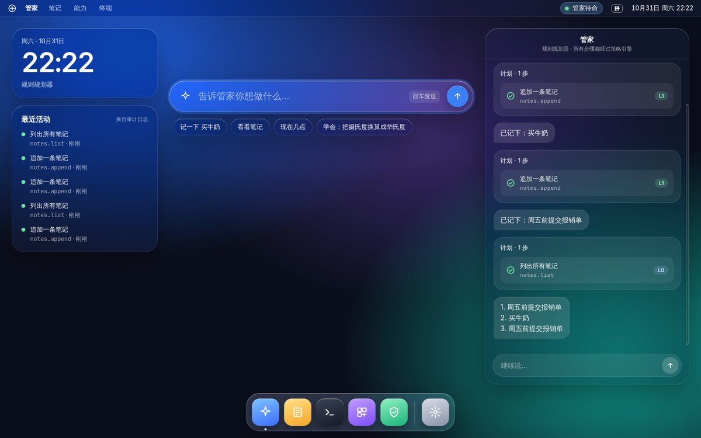
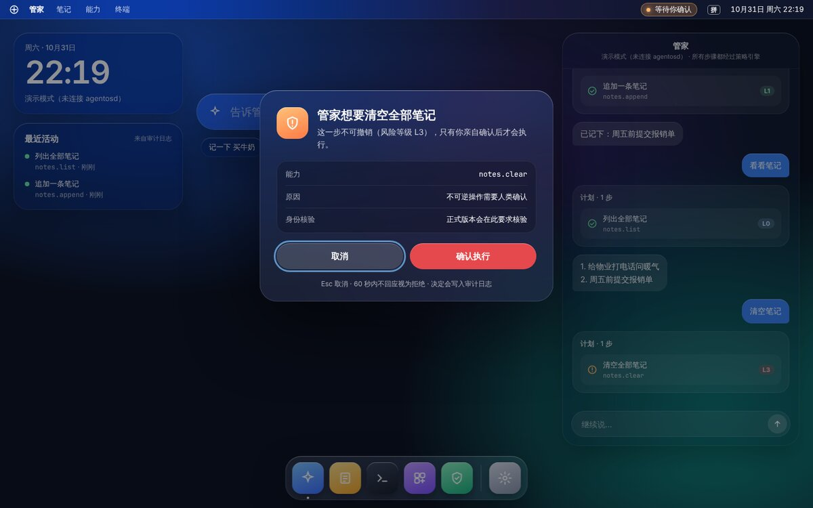

# 图形界面（agentos-shell）

AgentOS 的桌面借鉴了 macOS 的设计语言：半透明玻璃材质、大圆角、菜单栏和 Dock。但整个界面是围绕 Agent 设计的，核心是让人看清管家在做什么、并在关键时刻做决定。设计稿：[AgentOS 桌面设计稿](https://claude.ai/artifact/Rnp5b5VxBdSsKcMSN8DMta)。



| 区域 | 作用 |
| --- | --- |
| 菜单栏 | 右侧胶囊显示管家状态：待命、思考中、执行到第几步、等待确认、未连接；麦克风打开时亮起橙色标志，朗读时显示“正在播报 · 停止” |
| 意图栏 | 屏幕中间的主输入框，回车发送；按住麦克风按钮或 Caps Lock 说话（见 [voice.md](voice.md)）；下面是常用意图 |
| 管家面板 | 对话记录。每个计划画成卡片，逐步显示能力名、风险等级（L0–L3）和执行状态 |
| 最近活动 | 来自审计日志的能力调用和确认记录 |
| 确认弹窗 | 策略引擎要求确认时弹出，列出能力、原因和参数；默认焦点在“取消”，Esc 取消，60 秒不回应视为拒绝 |
| Dock | 管家、笔记、终端、能力与插件、最近活动、设置（强调色） |



## 结构

```
agentos-shell (WebKit 全屏窗口)  ⇄  Unix socket (JSON Lines)  ⇄  agentosd
        ui/index.html                    shell_api.rs              管家 → 策略引擎 → 能力 → 审计
```

- 界面整体画在一个 WebKit 窗口里（`crates/shell/ui/index.html`），所以毛玻璃效果不依赖合成器支持，sway 下也能用。
- shell 本身没有任何权限。它只把意图和确认结果转发给 `agentosd`，所有操作仍然经过策略引擎并写入审计日志。界面能让 shell 做的本地动作只有一个：打开终端。
- socket 权限是 0600，只有当前用户能连接。

## 运行

依赖（Debian 13 / Ubuntu 24.04）：

```sh
sudo apt install libwebkit2gtk-4.1-dev libgtk-3-dev   # 编译
sudo apt install libwebkit2gtk-4.1-0 fonts-noto-cjk fonts-inter   # 运行
```

```sh
# 终端 1：守护进程，打开图形界面接口
cargo run -p agentosd -- --listen $XDG_RUNTIME_DIR/agentos.sock

# 终端 2：图形界面（--windowed 以普通窗口运行，方便开发）
cargo run -p agentos-shell -- --windowed
```

`agentos-shell` 默认连接 `$XDG_RUNTIME_DIR/agentos.sock`，可用 `--socket` 或 `AGENTOS_SOCKET` 改。守护进程没启动或重启时，shell 每秒重连一次，菜单栏显示“未连接”。

在浏览器里直接打开 `crates/shell/ui/index.html` 会进入演示模式：不需要守护进程，内置一个很小的模拟管家，方便调整界面。

### 在 sway 里作为桌面

shell 是唯一的平铺窗口，铺满屏幕；终端等其他程序浮在它上面：

```
default_border none
for_window [app_id="agentos-shell"] border none
for_window [app_id="foot"] floating enable, resize set 960 600, move position center
exec agentosd --listen $XDG_RUNTIME_DIR/agentos.sock
exec agentos-shell
```

终端程序可用 `AGENTOS_TERMINAL` 指定（默认 `foot`）。

安装镜像里已经这样配置好了：`agentos-desktop` 启动 `agentos-daemon`（循环运行 `agentosd --listen`）和 `agentos-shell`；左上角系统菜单通过 `agentos-system` 执行固定的几项操作（终端、设置、安装、重启、关机），shell 拒绝其他任何名字。shell 连上 agentosd 后会写 `$XDG_RUNTIME_DIR/agentos-shell.ready`，开机自检和 QEMU 冒烟测试用它确认桌面已就绪。

## socket 协议

每行一个 JSON 对象。

shell → agentosd：

| 消息 | 含义 |
| --- | --- |
| `{"type":"intent","text":"记一下 买牛奶"}` | 新意图 |
| `{"type":"confirm","approved":true}` | 回答待确认的步骤 |
| `{"type":"listen","action":"start"}` | 按下说话键；`stop` 松开并识别，`cancel` 丢弃这次录音 |
| `{"type":"speech","mode":"auto"}` | 朗读模式：`auto` `always` `off` |
| `{"type":"speech","action":"stop"}` | 停止朗读 |

agentosd → shell：

| 消息 | 含义 |
| --- | --- |
| `hello` | 连接后第一条：规划器名称、版本、语音配置（`voice`：是否可用、识别/合成后端、音频发往哪里、朗读模式） |
| `activity` | 审计日志里最近 20 条能力调用、确认和麦克风使用 |
| `plan` | 计划：每一步的能力名、描述、风险等级 |
| `step` | 某一步的状态：`running` `done` `failed` `confirm` `denied` `cancelled` |
| `confirm` | 需要人确认：能力、描述、风险、原因、参数、是否需要身份核验 |
| `expression` | 管家说的话（`report` `error` 等） |
| `done` | 这个意图处理完了 |
| `voice` | 麦克风状态 `mic`（`idle` `listening` `transcribing`）、是否在朗读 `speaking`、朗读模式 `speak` |
| `voice_level` | 录音音量（0–1），约每 100 毫秒一次 |
| `transcript` | 识别出的文字，随后作为意图交给管家 |
| `voice_notice` | 语音相关的提示或错误（没配置、没声音、识别失败等） |

## 还没做的

- 插件审阅窗口（设计稿第 3 张）：现在插件安装走通用确认弹窗。
- 全局快捷键唤出意图栏（Caps Lock 说话目前只在 shell 有焦点时有效）。
