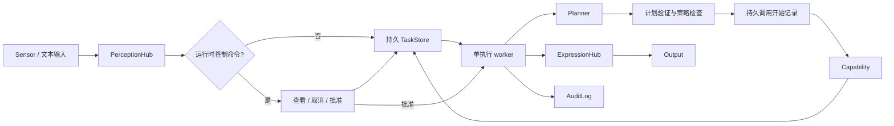
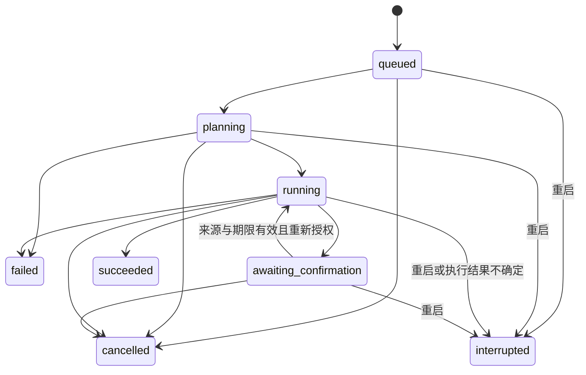

# AgentOS v0.2：让意图成为可管理的任务

本版把 AgentOS 从一次性意图处理原型推进到持久任务运行时。用户交付目标后，可以看到系统接受了什么、正在做哪一步、为何需要确认、最终结果是什么；守护进程重启后仍能解释之前的工作。

“未来操作系统”的核心价值，是替人协调长期目标、计算资源、工具、设备和权限。模型负责理解与规划，运行时负责执行约束、生命周期和事实记录。更换模型不能改变系统的授权边界，也不能改变任务是否已执行的事实。

## 审查结论

P0 已有清楚的模块边界：[`agentos-core`](../crates/core/src/lib.rs) 定义意图、设备和能力；[`agentos-policy`](../crates/policy/src/lib.rs) 将 grant 与风险分级分开判断；[`Butler`](../crates/agentosd/src/butler.rs) 串起规划与执行；[`agentos-audit`](../crates/audit/src/lib.rs) 记录执行轨迹。这些适合作为用户态 Agent OS 的起点。

P0 的主要缺口是任务没有独立于一次交互的生命周期。等待确认占用唯一的内存槽位，下一条输入被当成确认；进程退出会丢失计划与笔记；输入编号跨重启重复；执行中失败和重启后的结果不确定性没有可查询表示。继续扩展语音设备或工具数量，会放大这些问题。

| 方面 | P0 的问题 | v0.2 的处理 |
| --- | --- | --- |
| 任务管理 | 只有输入与即时输出，没有持久任务对象 | 持久任务 ID、状态、计划步骤、结果和原因 |
| 人工确认 | 任意下一条输入决定旧计划，普通任务被吞掉 | 显式任务与步骤批准命令，普通输入继续创建任务 |
| 权限 | 已确认步骤可跳过授权复查；L3 身份核验只是提示 | 每次调用仍检查 grant；没有可信身份核验时拒绝 L3 |
| 故障恢复 | 丢失内存状态，无法区分未执行与结果未知 | 未完成任务统一中断，保留步骤现场，不自动重放 |
| 数据 | 笔记只在内存，清空不可恢复 | 持久笔记与清空快照，恢复时保留后来新增的笔记 |
| 审计 | 写失败后继续执行，日志读取不验证序列 | 关键执行记录持久化失败即停止；校验历史记录和序列 |
| 交互响应 | 规划及执行阻塞输入循环 | 输入控制面与单执行 worker 分离 |

## 本版产品契约

1. **任务有身份。** 每条普通输入先成为持久任务，再进入执行队列。`task-N` 在同一状态目录内跨重启唯一，原始来源、说话者和意图随任务保留。
2. **任务可查看、可取消。** 控制命令由运行时解析，不交给模型。查看历史不会触发重新规划；取消阻止后续步骤，已进入能力调用的动作可能仍完成。
3. **批准只针对明确步骤。** 提示显示能力名称与参数；批准匹配任务、步骤、输入来源和说话者，并有五分钟有效期。批准不是授予新权限，也不是 L3 身份证明。
4. **重启不重复副作用。** 未完成任务进入 `interrupted`，不自动续跑或重试。用户先检查任务、审计与实际结果，再决定是否发起新任务。
5. **完成以执行结果为准。** 模型回复可以介绍计划，但只有能力执行结果和持久任务状态能表明工作是否完成。网络与解析失败应形成失败任务，不能伪装成成功的空计划。

## 用户态任务内核

新增 [`agentos-runtime`](../crates/runtime/src/lib.rs) 管理任务事实；[`Butler`](../crates/agentosd/src/butler.rs) 管理任务的执行策略；[`main.rs`](../crates/agentosd/src/main.rs) 提供输入、控制命令、任务队列与单 worker。

任务记录包含原始意图、状态、顺序步骤、步骤参数与结果、污点标记、确认期限、创建和更新时间。`TaskId` 是任务事实的主键；持久任务创建时将内部 `IntentId` 规范为同一数字，便于关联新的任务与审计记录。ID 只保证在同一状态目录内唯一，不是跨机器或跨独立目录的全局身份。

### 生命周期

`succeeded`、`failed`、`cancelled`、`interrupted` 都是终态。取消中的能力仍可返回，运行时把结果写入对应步骤，同时保持任务为 `cancelled`；任务取消不会被迟到的成功结果覆盖。

步骤按顺序执行：成功步骤组成前缀，后面最多有一个正在执行或失败的步骤，其余步骤等待。等待确认必须关联下一个待执行步骤；任务离开等待态时清除确认。无工具调用的正常回复可以成功结束；规划错误单独进入失败态。

### 持久化与重启

任务 snapshot 有独立 schema version，加载时验证 ID 分配、重复项、时间顺序、步骤顺序和确认状态。未知 schema 或损坏数据导致启动失败，保留原文件供检查。内存存储仅用于测试和嵌入场景，守护进程使用持久存储。

每次修改先构造候选状态并校验，再写同目录临时文件、同步文件、原子替换、同步目录，成功后才发布内存状态。状态目录持有 Unix 文件独占锁，避免两个守护进程同时写入同一任务集。snapshot 保存的是完整历史；本版没有归档、压缩和数据库索引，大规模历史需要后续引入分页与存储迁移。

默认审计与笔记文件位于这个受锁保护的状态目录，审计文件另持有独占写入锁。若使用 `--audit` 指定外部日志路径，同一文件也会拒绝第二个写入者。不同状态目录应使用独立日志，避免任务编号关联混淆。

重新打开存储时，`queued`、`planning`、`running`、`awaiting_confirmation` 都转为 `interrupted`，清除批准请求。已经记录的步骤结果保留，正在执行的步骤仍保留 `running` 现场，以表达“可能已经产生结果”。即使看起来尚未执行的任务也不自动启动，恢复行为保持一致且可解释。

### 调用前后的故障语义

能力得到执行控制权前，必须成功保存调用开始审计和步骤运行状态。调用返回后，再保存结果审计与步骤结果。关键持久化失败将停止剩余步骤。

任务 snapshot、审计日志和能力自身数据是独立持久化对象，本版没有跨它们的原子事务。崩溃可能发生在“动作已完成、结果尚未记录”的窗口。系统通过中断态表示这种不确定性，不承诺 exactly-once 执行，也不根据缺失结果推断动作没发生。

未来接入支付、邮件或远端服务时，应增加能力级幂等键、外部结果查询与人工对账；这些能力提供证据后，才适合实现自动恢复和安全重试。

## 权限与人工控制

[`PolicyEngine`](../crates/policy/src/lib.rs) 继续管理两个独立条件：Agent 是否拥有该能力的 grant，以及调用风险是否需要人工介入。规划器只获得已授予能力的描述；运行时验证整个计划的能力名称、授权和参数基本结构，然后在每一步执行前重新检查策略。

确认请求绑定原任务的输入设备、说话者、待执行步骤与有效期。用户界面使用从 1 开始的步骤号，内部使用从 0 开始的索引。worker 实际处理批准时检查期限，排队中的批准可能因等待过久而失效；重新表达意图后才会产生新的任务与确认请求。

来源匹配仅提供路由绑定，不提供可信身份。本版没有 PIN、硬件认证、系统账户认证或设备证明，因此遇到 `verify_identity` 要求时直接失败，不允许普通文本批准 L3 操作。

`tainted` 仍是由可信调用方提供的计划上下文标记，本版没有实现外部内容的端到端来源追踪。今后接入网页、邮件或 MCP 内容时，必须把来源、敏感级别和派生关系纳入系统上下文，不能依赖模型自行声明内容是否可信。

## 笔记作为最小持久应用

[`builtin.rs`](../crates/agentosd/src/builtin.rs) 的笔记用于验证任务运行时与应用数据的关系：写入立即持久保存，重启仍可读取；清空保留一份恢复快照，恢复把旧笔记放回并保留清空后新增内容。

清空因此改为 L1 可恢复操作。快照尚未恢复时，再次清空非空笔记会失败，以免覆盖唯一备份；清空空笔记也不会丢弃现有快照。这展示了 OS 应鼓励的能力设计：先让动作可撤销，再根据实际恢复保证确定风险等级。

此机制仅提供一次清空恢复，不是完整版本历史或事务回滚；取消任务不会撤回已经追加的笔记。一般性的撤销需要每个能力提供恢复契约，不能由任务状态机假定。

## 当前边界

- **用户态原型。** 这是运行于现有操作系统之上的任务运行时，还不是可启动的 Linux 发行版、桌面 Shell 或内核实现。
- **单用户、单 worker。** 可以持续接受输入和处理控制命令，但规划与能力执行仍串行。一个耗时调用会延迟后续任务与批准；资源配额、优先级、抢占和多 Agent 调度尚未实现。
- **没有 Linux sandbox。** 能力在守护进程内运行，grant 是可信代码的逻辑门禁；尚无进程隔离、cgroups、namespaces、seccomp 或 Landlock 限制，不能把不可信插件直接视为受隔离应用。
- **没有真实身份验证。** 来源、说话者字段并不等同于认证。L3 被拒绝，单用户假设也尚未升级为多用户权限模型。
- **单轮规划。** 模型一次返回顺序工具列表，尚不能根据前一步结果继续规划。模型路由、会话记忆和计划资源预算没有纳入本版。
- **基础设备抽象。** 当前只有文本输入和控制台输出；位置、模态、隐私等级字段尚未形成完整设备路由或数据出境策略。
- **本地明文数据。** 任务、工具参数、结果和审计可能包含个人信息；本版没有加密、保留期限或多租户访问控制。

## 验收关注点

验证围绕实际边界行为：跨重启 ID 与数据保存、未完成任务中断、历史不触发重执行、取消不会被迟到结果覆盖、明确步骤批准与来源/期限匹配、撤销授权后拒绝调用、L3 身份要求失败、审计故障停止副作用、损坏数据不被覆盖、第二进程不能打开同一状态目录，以及清空后的笔记可恢复。

离线规则规划器应覆盖核心体验；HTTP 规划器通过本地测试服务器验证请求及响应处理。真实云模型是否可用不应成为任务状态机正确性的前提。

## 后续路线

| 版本方向 | 核心成果 | 进入下一阶段前的条件 |
| --- | --- | --- |
| v0.3：系统控制面 | 本地 Unix socket 协议、独立 CLI/工作台、事件订阅、历史分页、客户端断开后的任务继续运行 | 身份与会话绑定、协议版本、背压、断线重连语义明确 |
| v0.4：能力进程与边界 | MCP/外部能力适配、Agent manifest、进程监督、最小权限、资源限制 | 风险元数据由可信安装流程提供，进程退出与超时可追踪，Linux sandbox 可验证 |
| v0.5：长期目标运行时 | 根据步骤结果进行多轮规划、预算、优先级、并发任务、幂等重试 | 工具调用有稳定身份与恢复契约，外部结果可查询，污点来源在上下文中保留 |
| 后续：设备与工作台 | 语音、TTS、位置与模态路由、隐私策略、任务视图和可信确认界面 | 设备身份、敏感输入处理和用户授权边界可审计 |

Linux 部署、systemd 服务化和目标硬件验证可以随这些阶段推进。优先把已有任务契约扩展为多个客户端和多个能力进程共享的系统服务，使 UI、设备和模型始终使用同一套任务事实与权限判断。
