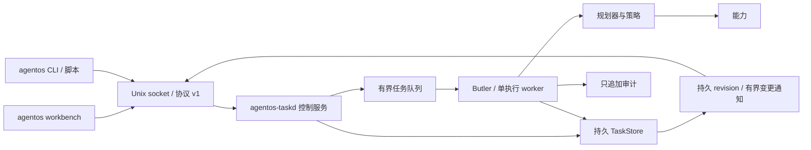

# AgentOS v0.3：系统服务与独立任务工作台

v0.3 将任务执行与终端交互分为两个进程。`agentos-taskd` 持有任务、能力、策略和审计，`agentos` 是通过 Unix socket 连接的独立客户端与终端工作台。关闭工作台不会关闭服务，任务也不会因为客户端断线而取消。

这一步把 v0.2 的持久任务内核变为可供多个客户端使用的本地系统服务。模型、设备和未来桌面界面共享任务事实与权限边界；界面不承担任务存储和执行职责。

## 组成



- `agentos-runtime`：持久任务、顺序分页、持久变更序号、提交成功后的变更通知。
- `agentos-ipc`：共享协议类型、有限长度 JSON Lines 帧、默认路径与系统用户辅助函数。
- `agentos_taskd::service`：socket 生命周期、客户端身份、请求路由、任务队列、订阅和服务关闭。
- `agentos-cli`：独立 `agentos` 可执行文件；单次命令用于脚本，`workbench` 提供实时任务页与详情。

核心执行仍沿用 v0.2：计划预检、逐步策略检查、调用前落盘、取消不覆盖在途结果、重启中断未完成任务。没有引入自动重试或把网络可达性当作执行事实。

## 使用流程

在一个终端启动服务：

```sh
cargo run -p agentos-taskd -- --planner rule --state-dir /tmp/agentos-demo
```

在另一终端连接工作台：

```sh
cargo run -p agentos-cli -- --state-dir /tmp/agentos-demo workbench
```

工作台可提交自然语言意图，查看任务状态、计划参数、步骤结果，取消任务或批准已经展示的确认请求。退出工作台只关闭客户端。也可以用独立命令提交和查询：

```sh
cargo run -p agentos-cli -- --state-dir /tmp/agentos-demo submit 记一下 买牛奶
cargo run -p agentos-cli -- --state-dir /tmp/agentos-demo tasks
cargo run -p agentos-cli -- --state-dir /tmp/agentos-demo task task-1
```

服务运行于前台，便于由现有服务管理器监督；它不读取 stdin，也不因 stdin 关闭而退出。SIGINT/SIGTERM 触发有界关闭，服务停止接收新连接，再处理已接收工作；未完成工作仍遵守重启中断、不自动重放的规则。

## 本机身份与确认

socket 由服务创建，权限限制为 `0600`。服务使用内核提供的 Unix peer credentials，只允许与服务相同的有效 UID。客户端也验证服务 UID；请求不接受客户端自报的设备或说话者身份。

新任务的来源被规范为系统用户身份，不绑定临时连接 ID。因此，同一系统账户打开的另一个终端或重连后的工作台可以管理原任务。这里的授权主体是本机 OS 用户；同一 UID 下的进程属于同一信任域，不是彼此隔离的多租户会话。

每次确认另生成随机令牌，存入该任务的具体确认请求。批准必须同时匹配任务、从 1 开始的步骤号、令牌、UID 来源与五分钟有效期。请求入队时校验一次，worker 执行时再次校验，随后仍检查 grant。旧请求、错误令牌、过期批准或已取消任务不能触发调用。

工作台从已经展示的详情取得令牌；独立 CLI 的批准命令要求显式提供令牌。令牌用于避免错用或重用具体确认请求，不是 L3 身份核验。当前仍没有可信 L3 验证设备，因此 L3 调用继续拒绝执行。

socket 启动时不会删除普通文件、符号链接或活跃服务。仅能清理属于当前用户且已失效的旧 socket；退出时只清理本实例创建的端点，避免误删替换后的文件。

## 协议 v1

完整线格式与错误语义见 [Unix socket 协议](protocol-v1.md)。每帧为 UTF-8 JSON 对象，以换行结束；有独立协议版本、请求 ID 和结构化错误。

| 方法 | 作用 |
| --- | --- |
| `ping` | 查询服务版本与当前 revision |
| `submit` | 持久创建任务并入队；成功响应携带稳定任务 ID |
| `list` | 按任务 ID 倒序分页，可按状态过滤 |
| `get` | 获取一个任务的完整计划、确认和结果 |
| `cancel` | 立即保存取消请求，停止后续步骤 |
| `approve` | 将已校验的具体批准排入执行队列 |
| `capabilities` | 查看能力描述与风险 |
| `watch` | 将当前连接切换为实时变更通知流 |

普通请求不依赖当前终端选中项，没有模型参与协议解析。`submit` 成功表示任务已持久接收，不表示执行完成；`approve` 成功表示批准已入队，不表示后续授权检查通过。最终状态应通过 `get`、`list` 或工作台确认。

## 分页、实时视图和重连

历史按递减任务 ID 排序，`before` 是排他的旧任务边界。每页同时返回内容、下一页游标与同一存储锁下读取的 revision，避免客户端把来自不同时刻的游标和页面误组合。状态过滤是实时查询，不提供跨页冻结的数据库事务快照；刷新最新页才能看到后来新建或状态变化的任务。

每次成功持久修改递增 revision，然后发布任务 ID 变更提示。revision 随任务快照保存，重启恢复未完成任务也会推进它。通知只表示需要刷新，不代替持久任务结果。

`watch` 在获取当前 revision 前先订阅，避免初始读取与订阅之间出现空窗。客户端提供旧游标时，如果不能证明视图仍有效，服务明确发送 `resync_required`，客户端重新读取任务页与详情。通知缓冲区溢出也用同样方式恢复；本版不提供持久事件重放。审计日志保留执行记录，订阅流服务于实时界面，两者职责不同。

工作台断线后自动退避重连并重建视图。**不会自动重发提交、取消或批准。** 如果连接在变更请求发出后、响应到达前断开，结果可能已经生效，界面应提示用户查询任务历史，不能自行推断请求失败并重试。

## 有界资源与故障行为

协议帧、意图文本、分页大小、并发连接、任务队列和订阅缓冲均有上限。队列容量先预留再创建任务，容量耗尽时返回明确错误，不创建无法入队的孤立任务。慢客户端写入超时后关闭该连接，不让其占住任务执行 worker。

坏 JSON、未知字段、不支持的协议版本、无效参数和不存在的任务形成结构化错误；帧超限或截断会关闭连接。大型详情超过帧上限时明确报错，不发送半个 JSON 对象。工作台清理来自用户或模型内容的终端控制字符，避免任务文本改变终端状态。

worker 异常退出会导致服务停止，不继续假装可以接收执行。所有客户端断开都不会触发任务取消。客户端视图过时只能引发重新查询，不能改变任务事实。

## 数据与迁移

v0.3 的任务快照增加 revision 与确认令牌。读取 v0.2 快照时保留任务 ID、终态结果和原始意图；未完成任务仍转为中断，清除旧确认。快照升级后供 v0.3 使用，不承诺旧程序可读取新版格式。

数据仍是本地明文，完整任务历史仍采用原子 JSON 快照；分页只减少查询与传输成本，没有替换底层全量快照写入。单 worker、单轮规划和单 OS 用户仍是本版边界。

## 后续

v0.4 应推进能力进程监督、manifest、MCP 适配与 Linux 资源隔离，使不可信能力不能直接共享守护进程的权限。任务控制协议可供后续桌面工作台、设备和受约束的应用 Agent 复用。并发调度、预算和安全自动恢复需要继续建立能力幂等与外部结果查询契约。
