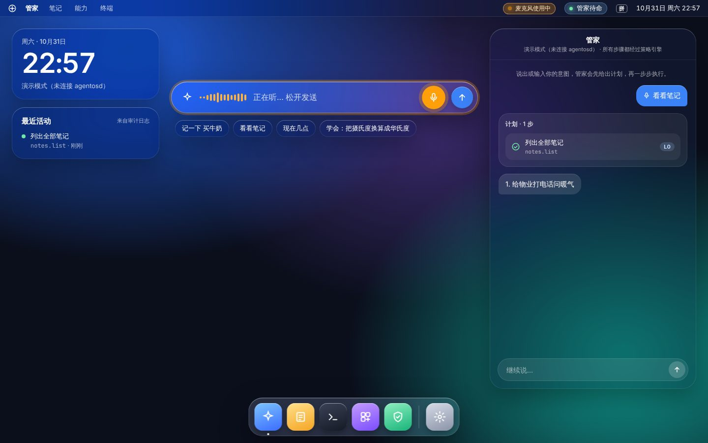

# 语音输入与朗读

按住说话，松开发送；管家的回复可以读出来。



麦克风和扬声器是 `agentosd` 里的两个设备：

```
按住麦克风按钮 / 右 Ctrl
  agentos-shell ──listen start──▶ agentosd ── arecord（16 kHz 单声道 PCM）
  松开          ──listen stop───▶          ── 语音识别（云端或本机）──▶ 文字意图（来源设备 mic）
                                                                         │
                                  管家 → 策略引擎 → 能力 → 回复 ◀───────┘
                                                            │
                                  扬声器设备 ── 语音合成 ── aplay
```

- 识别结果和打字一样变成意图，经过同样的规划、策略检查和审计。
- shell 不直接碰麦克风，录音由 `agentosd` 负责，这样每一次使用都能被显示和审计。

## 隐私

- **只在按住时录音。** 没有唤醒词，不会后台监听。单次最长 60 秒，到时自动发送。
- **麦克风打开时菜单栏一定亮起橙色标志**，鼠标悬停显示音频发往哪里。标志跟随守护进程的真实状态，而不是按钮状态。
- **每次录音都写入审计日志**（`device_used` 事件：时长、发往哪里，不含音频和文字）。桌面“最近活动”里能看到。
- **音频默认不出本机。** 只有在设置里明确选择了云端识别（`AGENTOS_STT=openai`）才会上传；配置本机识别程序则全程不联网。
- **语音不能批准不可逆操作。** L3 步骤（例如清空笔记）只能在屏幕上点“确认执行”；对着麦克风说“确认”会被拒绝，因为房间里的其他人或电视也能说出这两个字。语音可以随时说“取消”。L1/L2 的确认可以用语音。
- 太短（不到 0.3 秒）或没有声音的录音直接丢弃，不会发给识别服务。

## 配置

首次启动的设置向导（`agentos-setup`）里可以选择云端语音。手动配置写在 `/etc/agentos/agentos.env`：

| 变量 | 作用 |
| --- | --- |
| `AGENTOS_STT` | `openai`、`command` 或 `off`。不设时：设置了 `AGENTOS_STT_CMD` 就用本机命令，否则关闭 |
| `AGENTOS_TTS` | 同上，对应 `AGENTOS_TTS_CMD` |
| `AGENTOS_VOICE_BASE_URL` / `AGENTOS_VOICE_API_KEY` | 语音接口地址和 key，不设时沿用 `OPENAI_BASE_URL` / `OPENAI_API_KEY`。规划器用 DeepSeek 这类没有语音接口的服务时需要单独设置 |
| `AGENTOS_STT_MODEL` | 默认 `gpt-4o-mini-transcribe`（也可用 `whisper-1`，或其他服务的模型名） |
| `AGENTOS_STT_LANGUAGE` | 默认 `zh`；`auto` 表示让服务自己判断 |
| `AGENTOS_TTS_MODEL` / `AGENTOS_TTS_VOICE` | 默认 `gpt-4o-mini-tts` / `alloy` |
| `AGENTOS_SPEAK` | `auto`（默认，语音提问时朗读回复）、`always`、`off`。桌面设置里可以随时切换 |
| `AGENTOS_STT_CMD` | 本机识别命令，`{wav}` 会替换成临时 WAV 文件路径，从标准输出读文字 |
| `AGENTOS_TTS_CMD` | 本机合成命令，从标准输入读文字，向标准输出写 WAV |
| `AGENTOS_MIC_CMD` | 录音命令，需向标准输出写 16 kHz 单声道 s16le 原始 PCM。默认 `arecord -q -t raw -f S16_LE -r 16000 -c 1` |
| `AGENTOS_PLAY_CMD` | 播放命令，从标准输入读音频。默认 `aplay -q -` |

命令按空格拆分，不经过 shell；需要管道等复杂写法时请写成脚本。

### 云端（OpenAI 兼容接口）

需要服务支持 `POST /audio/transcriptions`（multipart 上传 WAV）和 `POST /audio/speech`（返回 WAV）。OpenAI 本身可以直接用；Groq、SiliconFlow、本地的 faster-whisper-server / speaches 等兼容服务也可以，模型名按服务填写。

```sh
AGENTOS_STT=openai
AGENTOS_TTS=openai
AGENTOS_VOICE_API_KEY=sk-...
```

### 完全离线（whisper.cpp + Piper）

```sh
AGENTOS_STT_CMD=/opt/whisper.cpp/whisper-cli -m /opt/whisper.cpp/ggml-small.bin -l zh -nt -np -f {wav}
AGENTOS_TTS_CMD=/opt/piper/piper --model /opt/piper/zh_CN-huayan-medium.onnx --output_file -
```

## 快捷操作

| 操作 | 方式 |
| --- | --- |
| 说话 | 按住意图栏右侧的麦克风按钮，或按住**右 Ctrl**；松开发送 |
| 放弃这次录音 | 按住右 Ctrl 时按任何其他键（例如切换输入法），或把窗口切走 |
| 停止朗读 | 菜单栏的“正在播报 · 停止”，或 Esc；开始说话也会打断朗读 |
| 朗读设置 | Dock 里的“设置” → 朗读回复：语音提问时 / 总是 / 关闭 |

只朗读结果、错误和确认请求，不读计划；超过 240 字的回复只读开头，完整内容看屏幕。

## 音频系统

镜像里装了 PipeWire（`pipewire pipewire-alsa pipewire-pulse wireplumber`）和 `alsa-utils`。`arecord` / `aplay` 通过 pipewire-alsa 连到当前会话的 PipeWire，所以用的是系统默认的麦克风和扬声器。

麦克风没声音时，先在终端里试：

```sh
arecord -d 3 -f S16_LE -r 16000 -c 1 /tmp/t.wav && aplay /tmp/t.wav
wpctl status          # 看默认输入设备
```

## 还没做的

- 本机唤醒词（“管家”）和连续对话。按设计要放在本机小模型上，且同样只在用户开启时监听。
- 声纹核验：L3 步骤将来可以用声纹 + 屏幕确认。
- 流式识别（边说边出字）和流式朗读。
